# Rshiny_dev

面向营销组合建模（MMM）与投放优化的 R Shiny 分析平台。项目基于 Robyn 模型结果，提供从模型配置、ROI 分析、预算分配、场景模拟到 Dashboard 可视化与 AI Assistant 对话分析的一体化工作台。

## 1. 项目概览

本项目主要用于将 MMM 模型能力产品化，支持业务团队在统一界面中完成：

- 模型数据加载与地区切换（全国 / 北京 / 深圳）
- 目标导向的预算优化与场景生成
- 渠道响应曲线与边际 ROI 分析
- 预测模拟（Simulator）与参数管理
- 业务指标可视化 Dashboard
- AI Assistant 多轮问答（含历史会话）
- 登录鉴权与角色化菜单权限控制

## 2. 核心功能

### 2.1 Settings（模型与基础配置）

- 支持按地区加载模型 JSON 与配套 CSV
- 展示输入数据、模型性能与超参数等信息
- 作为其他模块的数据源入口

### 2.2 Optimization（场景优化）

- 提供两类典型场景：
  - 通过优化投资缩小销售差距
  - 在预算限制下最大化销售额
- 输出投放建议图表与结果表格

### 2.3 ROI Analysis（响应与回报分析）

- 渠道响应曲线
- 边际 ROI 曲线
- 方案对比
- 支持数据下载，便于二次分析

### 2.4 Allocator（预算分配）

- 基于 Robyn allocator 能力进行预算分配
- 辅助评估渠道投入区间与分配结构

### 2.5 Dashboard（结果看板）

- 汇总关键业务表现与渠道贡献
- 支持按地区切换视角
- 近期持续修复了增量销售、同比一致性与图表展示问题

### 2.6 Simulator（预测模拟器）

- 左侧参数面板 + 右侧结果区布局
- 支持动态参数分组、滚动输入与结果联动
- 支持参数重置、配置导出/导入

### 2.7 AI Assistant（对话分析）

- 引入 LLM 进行意图识别与分析结论润色
- 支持会话历史保存与回放
- 支持旧版对话存储结构自动迁移
- 回答中可联动导航到相关分析模块

## 3. 技术栈

- R / Shiny / shinydashboard / bslib
- Robyn（MMM 建模与预算分配）
- tidyverse / dplyr / purrr / plotly / reactable
- jsonlite / digest / httr
- Qwen API（AI Assistant 对话能力）

## 4. 目录结构（关键）

```text
.
├─ app.R                    # 主入口（模块装配、鉴权、全局状态）
├─ app_simulator.R          # 独立模拟器入口（实验/验证）
├─ modules/                 # 业务模块（UI + Server + LLM服务）
│  ├─ dashboard_ui.R
│  ├─ dashboard_server.R
│  ├─ simulator_ui.R
│  ├─ simulator_server.R
│  ├─ chat_ui.R
│  ├─ chat_server.R
│  └─ llm_service.R
├─ model/                   # Robyn模型与配套输入输出（分地区/分版本）
├─ data/
│  └─ chat_history.json     # AI会话持久化数据
├─ dsw/                     # 另一套应用结构（部署/运行版本）
├─ Archived/                # 历史版本归档
├─ preview/                 # 聊天界面预览资源
├─ test/                    # 实验脚本与验证文件
└─ rsconnect/               # shinyapps.io 部署记录
```

## 4.1 页面截图

以下截图来自当前运行中的系统页面（按菜单顺序）：

### Settings

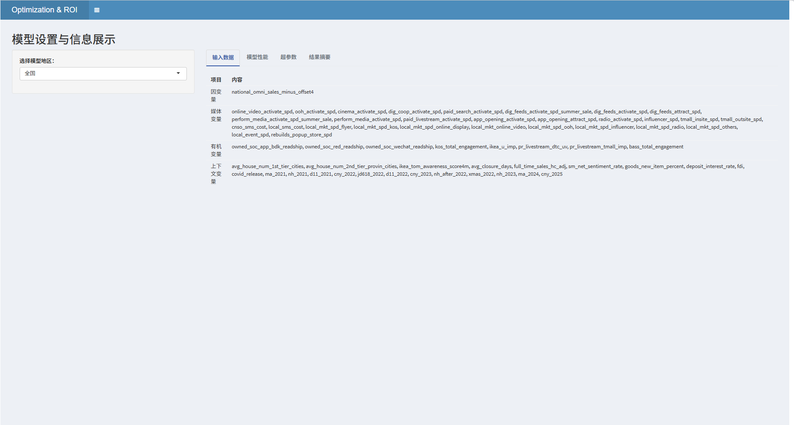
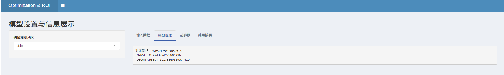
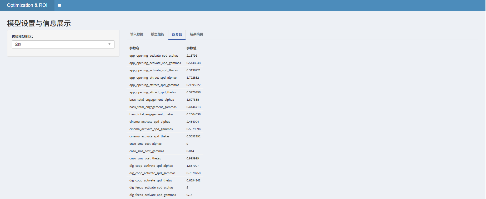
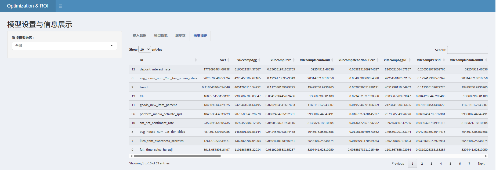

### Optimization

<!--  -->
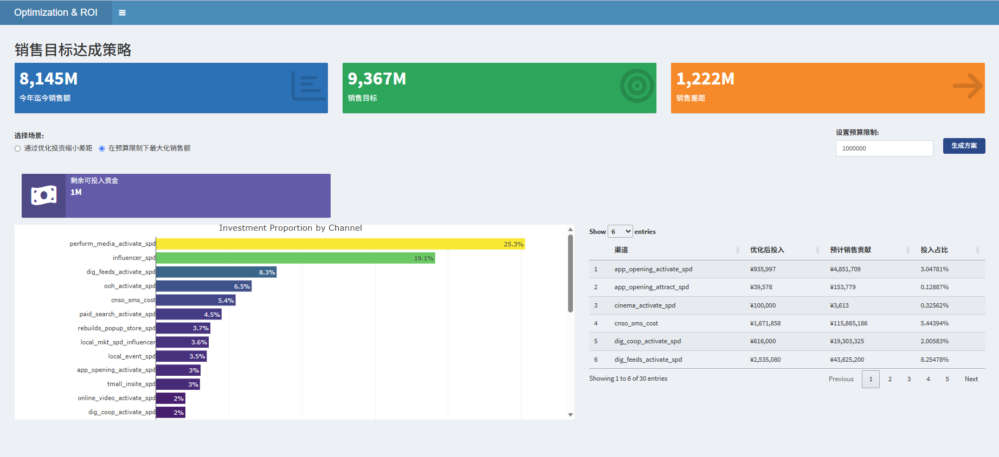
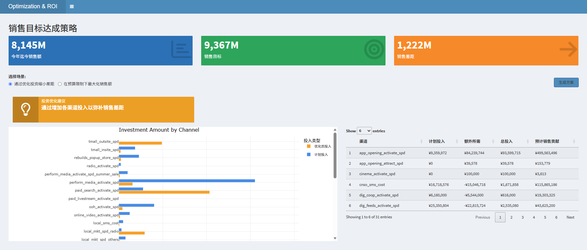

### ROI Analysis

<!--  -->
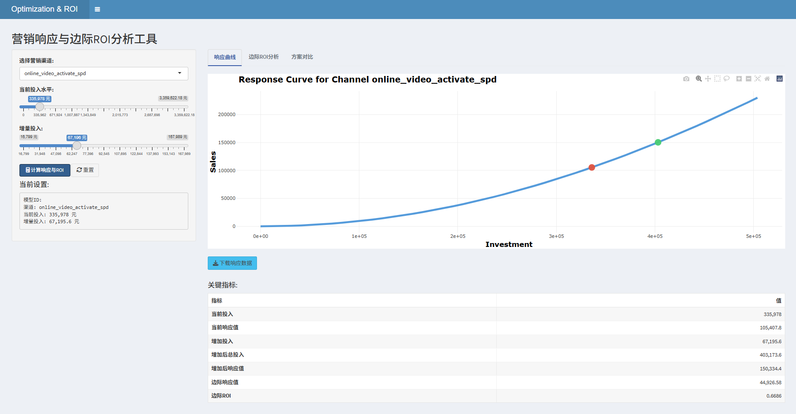
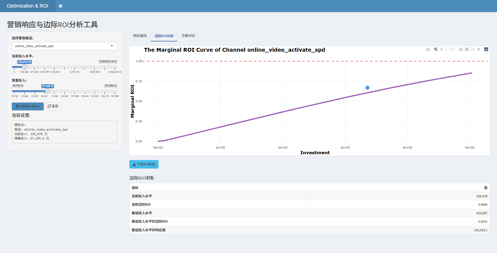
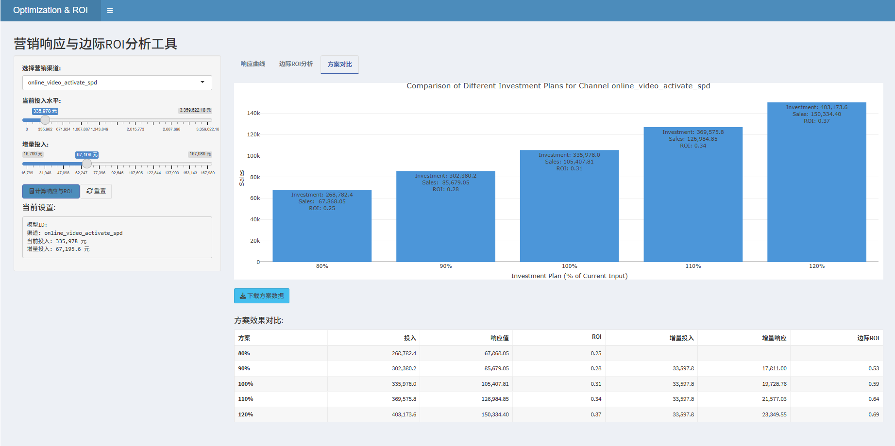

### Allocator

<!--  -->
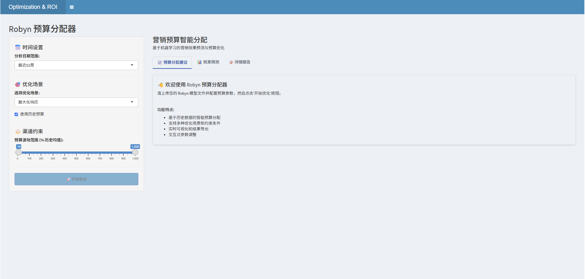
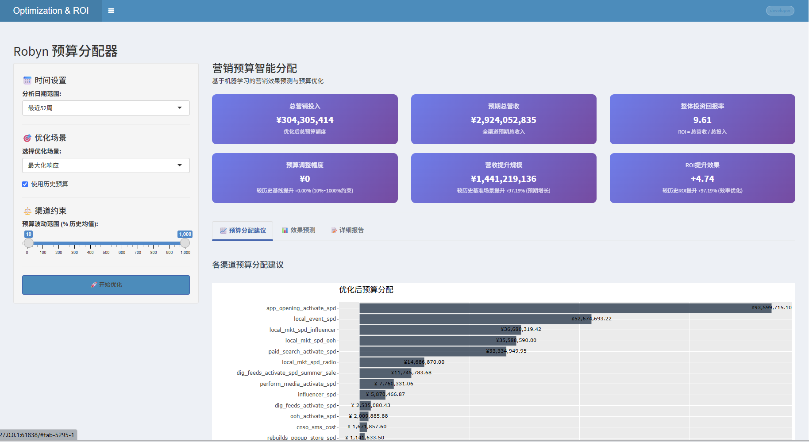

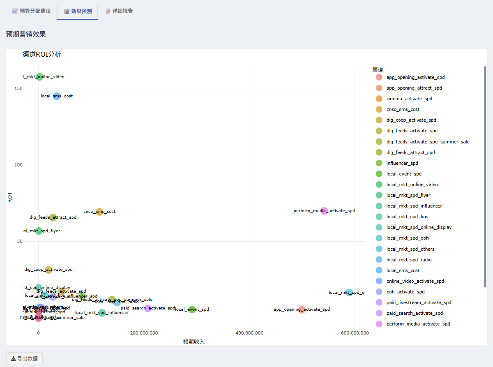
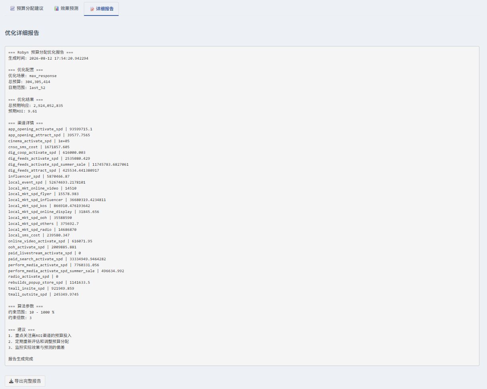

### Dashboard

<!--  -->
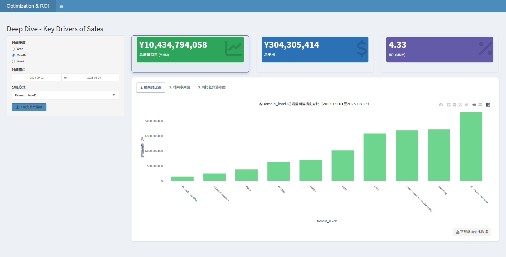
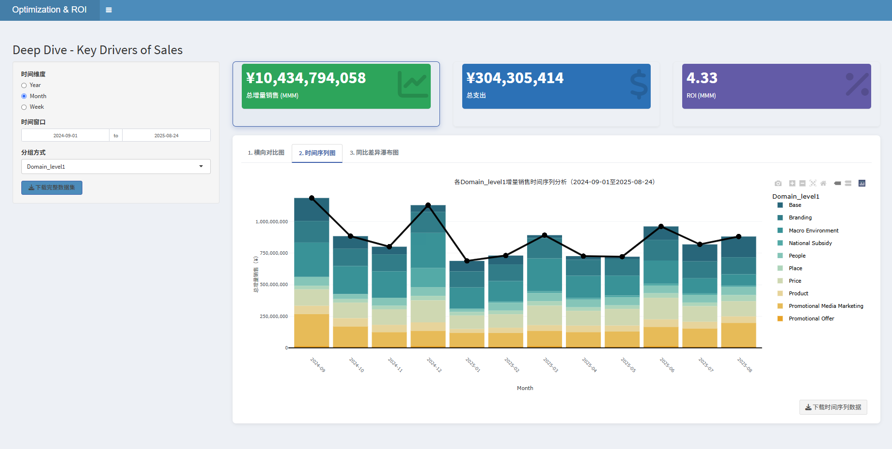
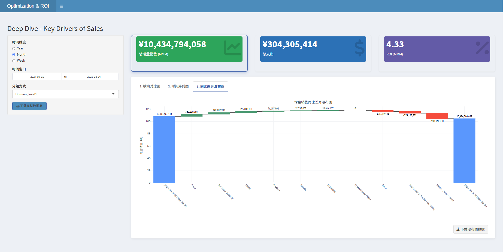
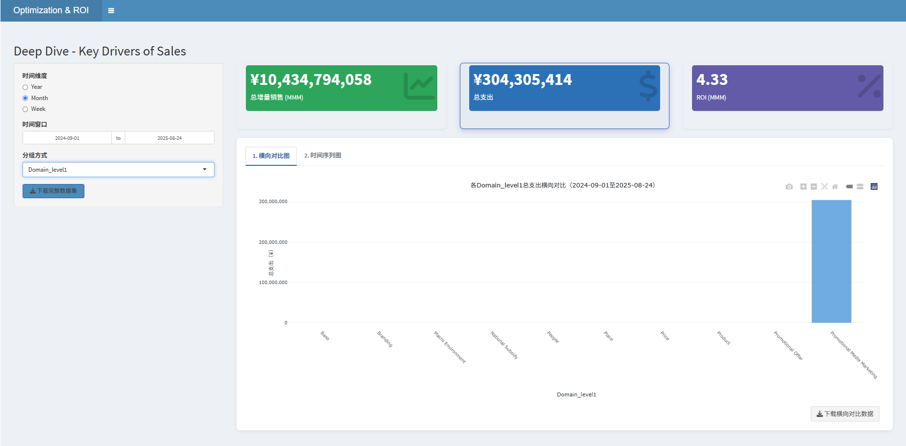

### Simulator

<!--  -->
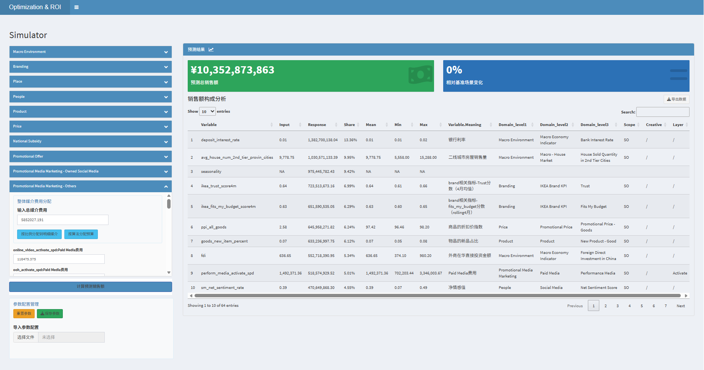
### AI Assistant

<!--  -->
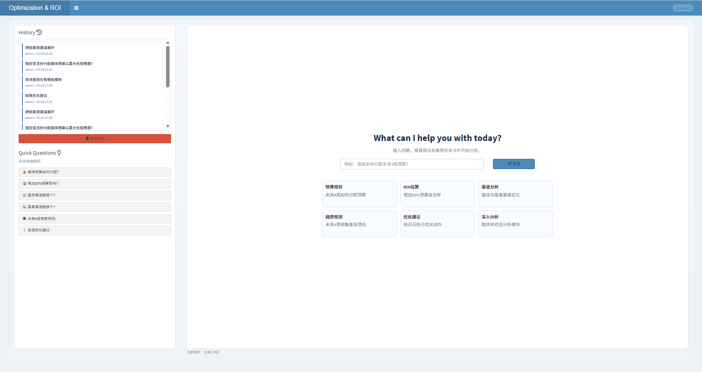
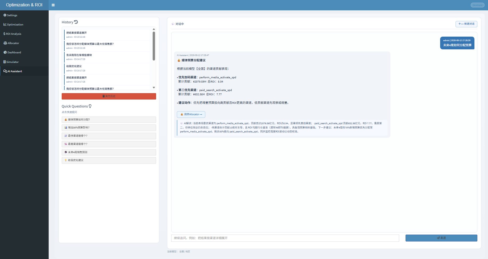

## 5. 快速开始

## 5.1 环境准备

建议：

- R 4.2+
- RStudio（可选）
- 已安装系统级编译环境（如需安装某些源码包）

安装依赖（在 R 控制台执行）：

```r
install.packages(c(
  "shiny", "shinydashboard", "shinyWidgets", "shinyjs",
  "tidyverse", "dplyr", "purrr", "tibble", "scales",
  "plotly", "reactable", "bslib", "jsonlite", "fs", "stringr",
  "digest", "httr"
))

# Robyn 如未安装，请按官方文档安装
# remotes::install_github("facebookexperimental/Robyn")
```

如使用 renv，可恢复锁定依赖：

```r
renv::restore()
```

### 5.2 启动应用

在项目根目录执行：

```r
shiny::runApp("app.R")
```

或在 RStudio 直接打开项目文件后运行应用。

### 5.3 登录说明

应用启用了登录与角色控制，默认存在开发测试账号（见代码配置）。

注意：默认账号仅适用于本地开发测试，部署到生产环境前请替换为安全鉴权方案。

## 6. AI Assistant 配置

AI 功能依赖 Qwen API Key。在项目根目录 `.Renviron` 配置：

```env
QWEN_API_KEY=sk-xxxxxxxxxxxxxxxx
```

重启 R 会话后生效。

## 7. 数据与模型说明

- 模型文件位于 `model/`，按地区与迭代版本组织
- 当前主入口默认模型路径指向 T3 模型目录
- 地区映射在主应用中维护（全国 / 北京 / 深圳）
- 各地区通常包含：
  - `RobynModel-*.json`
  - `pareto_hyperparameters.csv`
  - `pareto_aggregated.csv`
  - `pareto_alldecomp_matrix.csv`
  - 映射与系数等补充文件

## 8. 最近版本演进（基于提交历史）

近期改造与修复重点：

- 新增 AI Assistant 模块并持续优化展示与交互
- 增加角色基础的页面访问控制与动态菜单渲染
- 修复 Dashboard 增量销售与同比差异一致性问题
- 改造 offset 列读取为动态数据适配
- 修复 Dashboard 图表显示与数值展示问题
- 修复 Simulator 页面切换与稳定性问题
- 调整设置页数据精度与结果摘要展示

整体趋势：项目已从“基础模拟器”演进为“多模块、可鉴权、可对话”的营销分析平台。

## 9. 部署说明

- 仓库包含 `rsconnect/`，可用于 shinyapps.io 部署配置参考
- 建议在部署环境中：
  - 管理好模型文件与数据文件权限
  - 使用环境变量注入密钥，不在代码中硬编码
  - 关闭开发调试开关并替换默认登录账号

## 10. 后续建议

- 增补页面截图与业务流程图，提升可读性
- 增加模块级测试脚本与回归清单
- 将鉴权升级为企业 SSO / OAuth
- 为关键指标口径提供统一数据字典

---

如需，我可以继续补一版“面向业务同学”的 README（弱化技术细节，强调使用流程与常见问题）。
